<p align="center">
  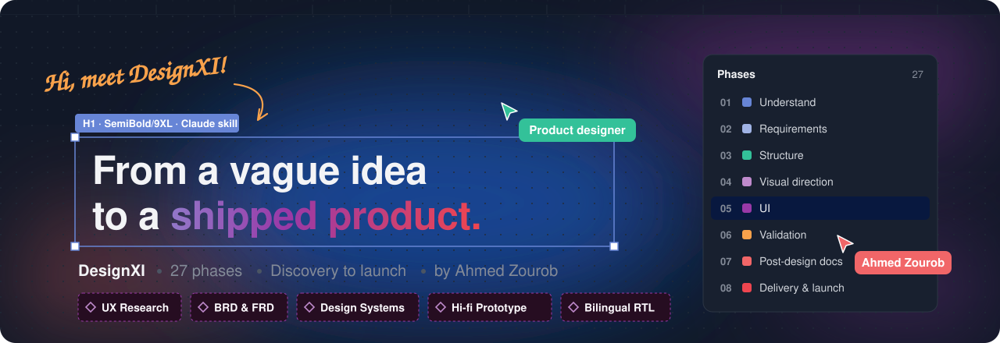
</p>

<p align="center">
  <a href="#example-nabd--the-process-stage-by-stage"><b>See the example</b></a> ·
  <a href="#install"><b>Install</b></a> ·
  <a href="#how-to-use"><b>How to use</b></a> ·
  <a href="https://htmlpreview.github.io/?https://github.com/ahmeduxui/DesignXI/blob/main/examples/nabd-clinic-dashboard/index.html"><b>Open the demo</b></a>
</p>

## What is DesignXI?

DesignXI is a **Claude skill** that turns Claude into a senior UX/UI designer who follows a real design process instead of jumping straight to screens.

You describe a product. DesignXI walks you through **27 ordered phases**, from understanding the problem to launch. You approve each phase before the next one starts. At the end you have research, requirements, wireframes, a design system, hi-fi interactive screens, a case study and a developer handoff.

**The core rule:** no visual design before the problem and the users are understood.

## Who is it for?

- **Designers** who want a structured partner for a full project or a portfolio case study
- **Founders and product managers** who need to go from an idea to tested screens and clear requirements
- **Developers** who need specs, tokens and a clean handoff, not just pretty pictures
- **Arabic products** — RTL and bilingual (Arabic + English) design is built in, not added later

## How it works

<p align="center">
  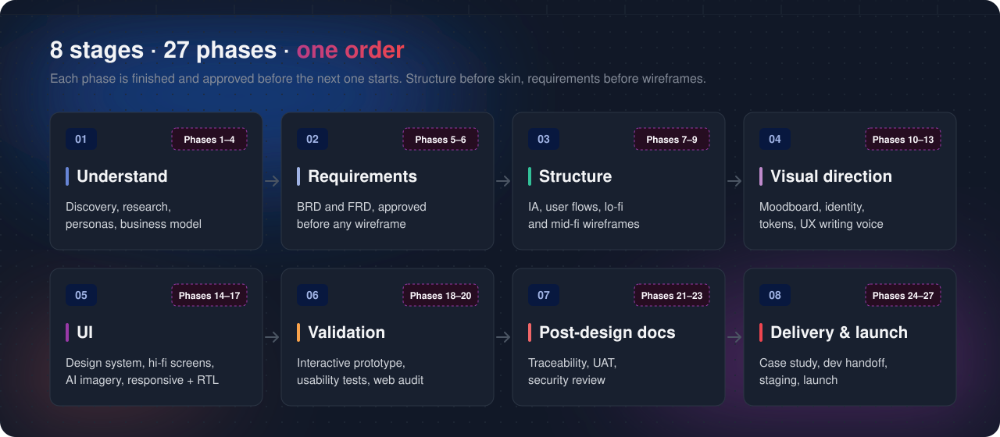
</p>

| Stage | Phases | What you get |
| --- | --- | --- |
| **1 · Understand** | 1–4 | Problem definition, Five Whys, SWOT, live competitor research, personas, empathy and journey maps, user stories, business model canvas |
| **2 · Requirements** | 5–6 | BRD and FRD (13 sections), approved before any wireframe |
| **3 · Structure** | 7–9 | Information architecture, user flows, lo-fi and mid-fi wireframes with empty / loading / error states |
| **4 · Visual direction** | 10–13 | Moodboard, design school, colors, fonts, icons, design tokens, product voice in Arabic and English |
| **5 · UI** | 14–17 | Component library, every screen in hi-fi, AI-generated imagery (with prompts), responsive + RTL, WCAG self-critique |
| **6 · Validation** | 18–20 | Clickable prototype, usability test plan and findings, web compliance audit |
| **7 · Post-design docs** | 21–23 | Screen ↔ requirement traceability, acceptance tests (UAT), security review |
| **8 · Delivery & launch** | 24–27 | Case study, device mockups, developer handoff, staging checklist, launch plan |

Small projects can skip what they don't need. DesignXI asks about project size at the start (Step 0) and adjusts.

## What you get (files)

| File | Contents | Example |
| --- | --- | --- |
| `index.html` | Start here: one page that links every file | [Open example](https://htmlpreview.github.io/?https://github.com/ahmeduxui/DesignXI/blob/main/examples/nabd-clinic-dashboard/index.html) |
| `process.html` | The living project log: research, requirements, wireframes, decisions, tests | [Open example](https://htmlpreview.github.io/?https://github.com/ahmeduxui/DesignXI/blob/main/examples/nabd-clinic-dashboard/process.html) |
| `screens.html` | The interactive prototype: every screen, every state, both languages | [Open example](https://htmlpreview.github.io/?https://github.com/ahmeduxui/DesignXI/blob/main/examples/nabd-clinic-dashboard/screens.html) |
| `casestudy.html` | A portfolio-ready case study | [Open example](https://htmlpreview.github.io/?https://github.com/ahmeduxui/DesignXI/blob/main/examples/nabd-clinic-dashboard/casestudy.html) |
| `handoff.html` | Specs, tokens and RTL notes for developers | [Open example](https://htmlpreview.github.io/?https://github.com/ahmeduxui/DesignXI/blob/main/examples/nabd-clinic-dashboard/handoff.html) |
| `images/` | Generated images, each with its copy-ready prompt | [Open example](examples/nabd-clinic-dashboard/image-prompts.md) |

The examples come from **Nabd**, a demo project described below.

Deliverables can be a single offline HTML file, separate files, or developer code. DesignXI asks which one you want.

## Example: Nabd — the process, stage by stage

One prompt: *"Design a SaaS dashboard for small clinics to manage appointments and patients."* DesignXI ran all 27 phases on it. Nabd and the people in it are fictional; the competitor research is real.

What each stage produced, in order. The screens come last, after the problem, the users and the structure are settled.

<table>
  <tr>
    <td width="50%">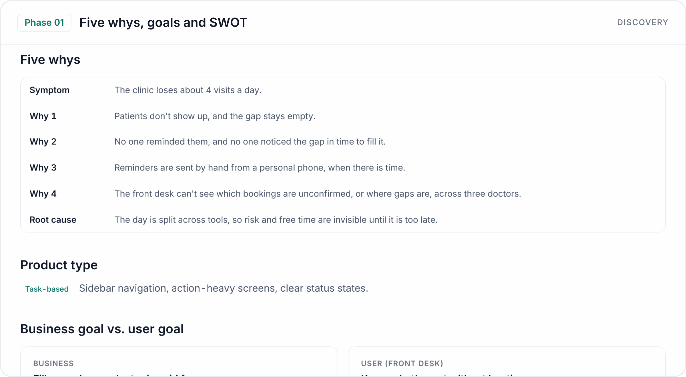</td>
    <td width="50%">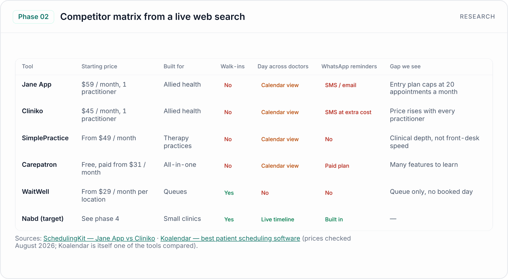</td>
  </tr>
  <tr>
    <td width="50%">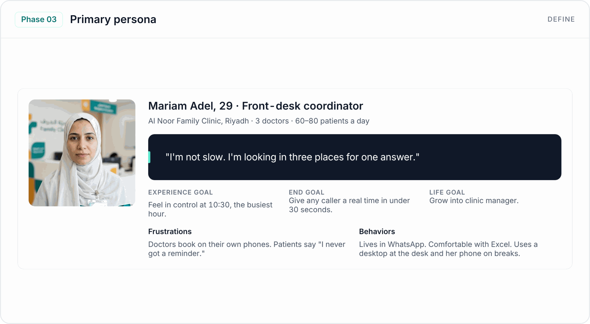</td>
    <td width="50%">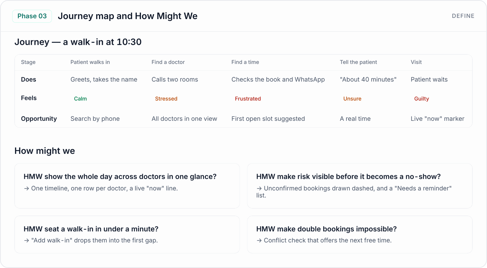</td>
  </tr>
  <tr>
    <td width="50%">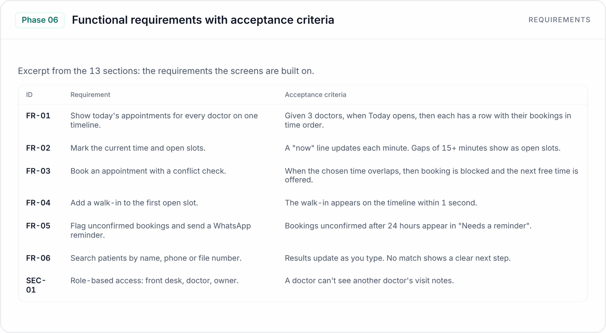</td>
    <td width="50%">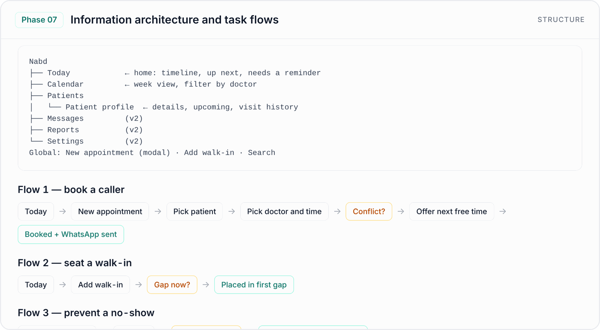</td>
  </tr>
  <tr>
    <td width="50%">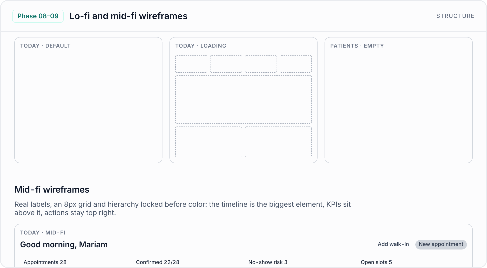</td>
    <td width="50%">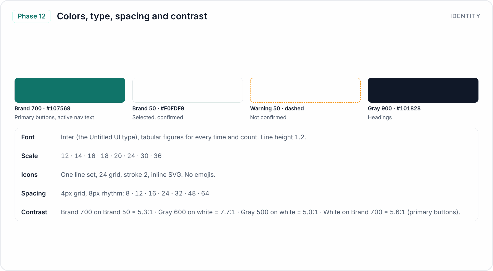</td>
  </tr>
  <tr>
    <td width="50%">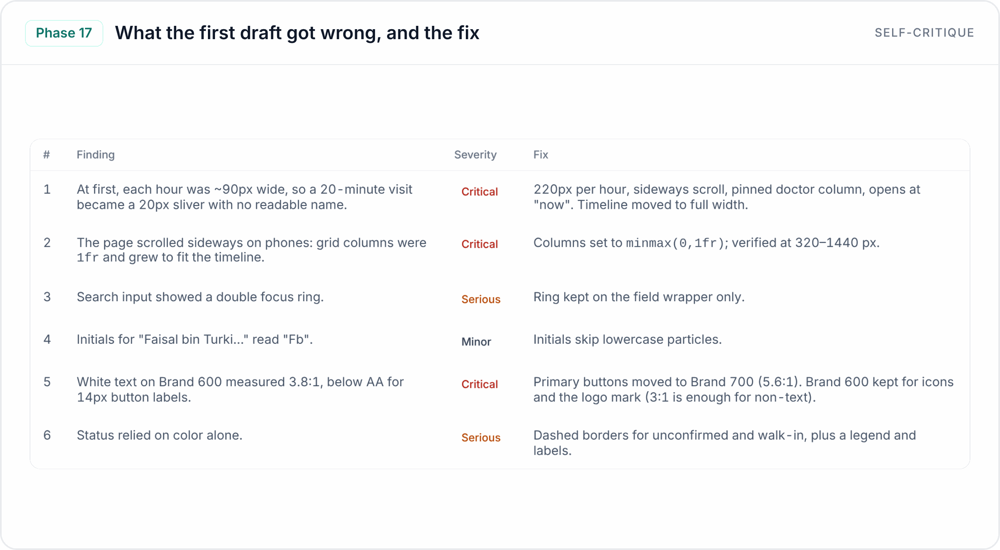</td>
    <td width="50%">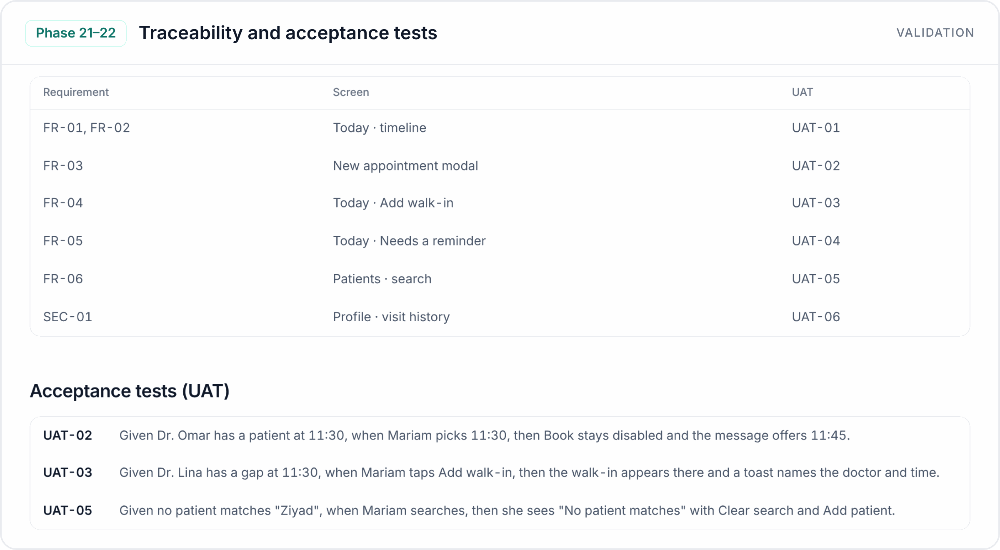</td>
  </tr>
  <tr>
    <td width="50%">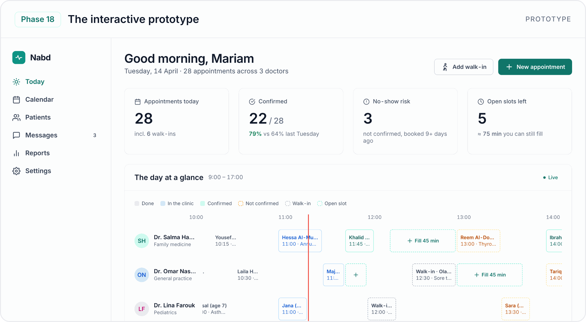</td>
    <td width="50%">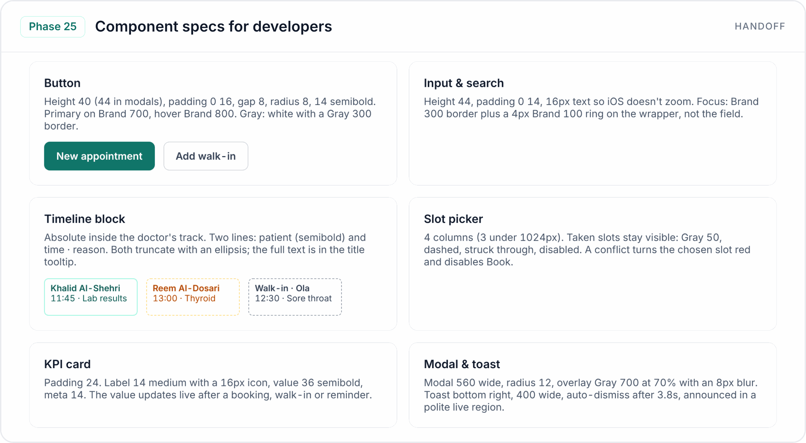</td>
  </tr>
</table>

**[Start at the project overview](https://htmlpreview.github.io/?https://github.com/ahmeduxui/DesignXI/blob/main/examples/nabd-clinic-dashboard/index.html)** · [All details →](examples/nabd-clinic-dashboard/README.md)

## Install

**Claude app (web, desktop)**

1. Download [`designxi.zip`](designxi.zip) from this repository.
2. In Claude, open **Settings → Capabilities** and make sure code execution and file creation is on.
3. In the Skills section, click **Upload skill**, choose the ZIP and turn the skill on.

**Claude Code**

```bash
git clone https://github.com/ahmeduxui/DesignXI.git
cp -r DesignXI/designxi ~/.claude/skills/
```

## How to use

Just describe what you want to build. The skill starts on its own when you ask for a product, an app, a dashboard or a website. You can also call it by name with `/designxi`.

Example prompts:

The prompt behind the [Nabd example](examples/nabd-clinic-dashboard/README.md):

```text
/designxi Design a SaaS dashboard for small clinics to manage appointments and patients.
```

More ideas:

```text
/designxi Design a booking app for padel courts in Riyadh, Arabic first.
```

```text
Create a portfolio case study for my food-delivery redesign.
```

```text
Redesign our company website. Here are screenshots of the current one.
```

**Tips**

- Attach what you have: briefs, screenshots, old designs, Figma links. DesignXI reads them in Step 0.
- Answer the questions. Each phase asks a few, and your answers shape the next phase.
- Say "continue" to move to the next phase, or "go back to phase 7" to change something.

## Quality rules

DesignXI holds every project to the same rules:

- No lorem ipsum. Real content only.
- No UI before the UX is approved. No wireframes before requirements.
- Design tokens only. No hardcoded colors. 8pt spacing grid.
- One icon library per project. No emojis as icons.
- Every screen has its empty, loading and error states.
- Dark mode, if chosen, is verified in both themes.
- No generic "AI look". Every design must answer: *what is the one thing the user will remember?*

## What's inside

```text
examples/
└── nabd-clinic-dashboard/  A demo project: process, prototype, case study

designxi/
├── SKILL.md                     The 27 phases and how to run them
└── references/
    ├── phase-*.md               Deep guides for each stage
    ├── templates/               Templates for process, screens, case study, FRD, personas
    ├── mini-skills/             Color, typography, spacing, tokens, grids, dark mode, QA…
    ├── design-intelligence/     Searchable data: styles, palettes, fonts, stacks, UX rules
    ├── design-systems/          Ready systems: Untitled UI, Apple, Salla
    ├── apple-hig/               Apple Human Interface Guidelines, grouped for review
    ├── rtl-arabic.md            RTL and Arabic typography rules
    ├── accessibility-wcag.md    WCAG checks
    └── scripts/                 Image helpers for mockups and embedding
```


---

## Author

**Ahmed Zourob** — Product Designer.

## License

[MIT](LICENSE) © 2026 Ahmed Zourob.

The Apple Human Interface Guidelines text in `designxi/references/apple-hig/hig/` belongs to Apple Inc. and is not covered by this license. Third-party data in `designxi/references/design-intelligence/data/` keeps its own license.
